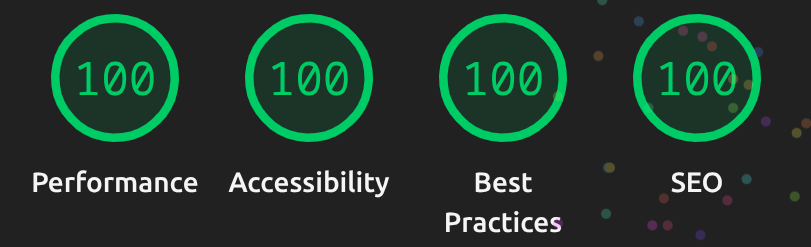
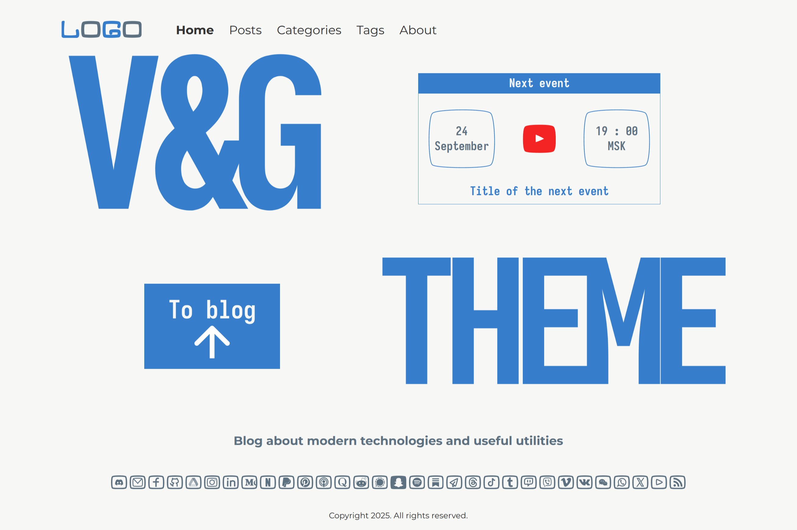
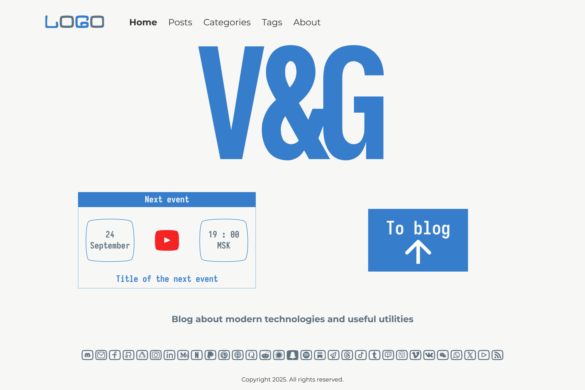
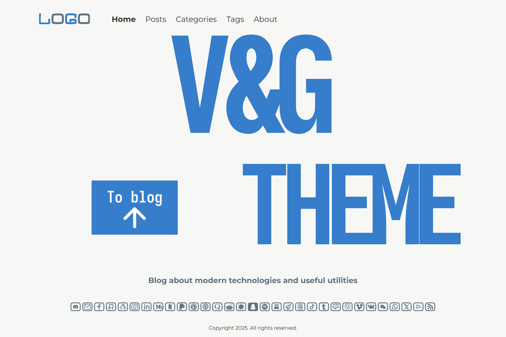
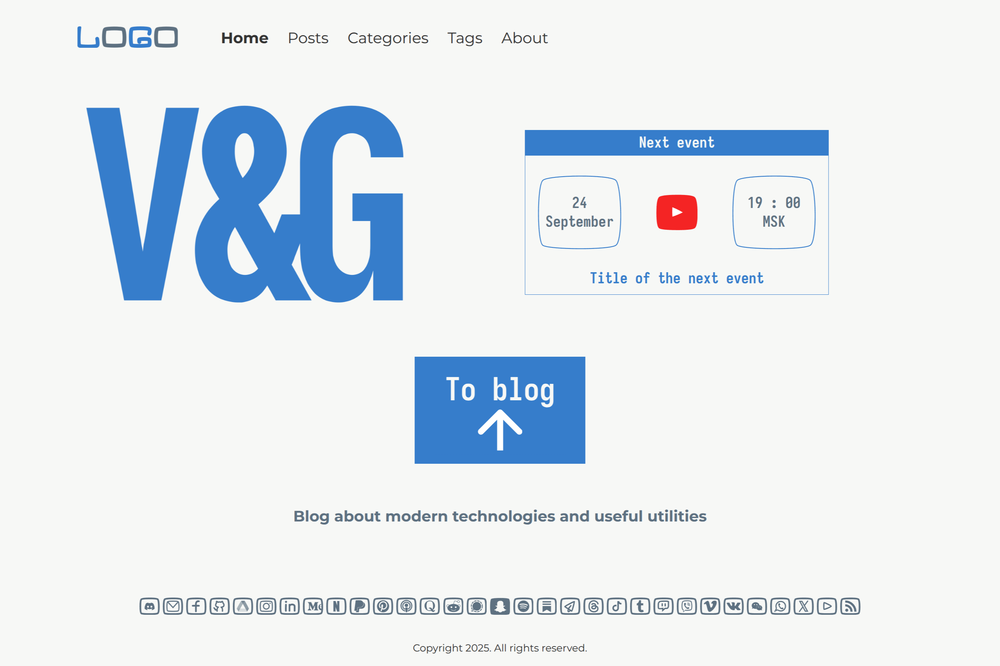
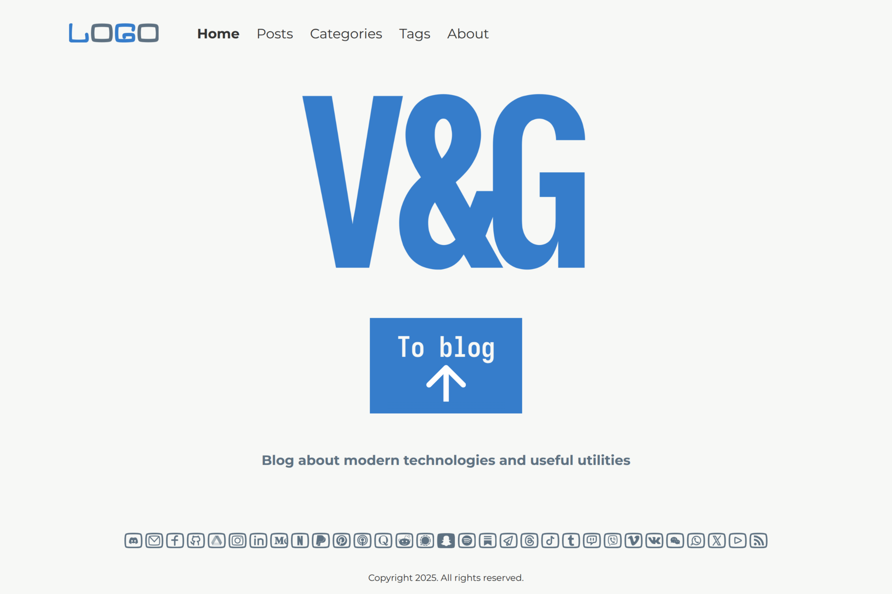

# V&G Blue theme for Hugo

A responsive Hugo blog theme with a perfect Lighthouse score, a flexible home page, and 30+ ready-to-use social network icons.

[Demo website](https://ismd.github.io/demo-hugo-theme-vng-blue/)



## Features

- **Perfect Lighthouse score** — 100/100/100/100 across Performance, Accessibility, Best Practices and SEO, on both **desktop and mobile**
- **"Next event" block on the home page** — a built-in section for announcing upcoming events, with three layout options (`top`, `bottom`, `none`)
- **30+ social network icons** included out of the box — from mainstream (X, Instagram, LinkedIn, YouTube, GitHub) to niche (Signal, Substack, Threads, WeChat, Viber, VK)
- **Responsive design** with a hamburger menu and HiDPI (2x) image support
- **Tag filtering** on the tags page with URL state — share or bookmark filtered views
- **Categories** with a collapsible sidebar list
- **About page with tabs** for sectioned profile content
- **Giscus comments** on single post pages
- **Multilingual** — a language switcher, `hreflang` links and translated interface (English and Russian included)

## Installation

### Hugo Modules (recommended)

Initialize your site as a Hugo Module (if it isn't already):

```bash
hugo mod init github.com/your-username/your-site
```

Add the theme to your site configuration.

`hugo.toml`:

```toml
theme = ["github.com/ismd/hugo-theme-vng-blue"]

[module]
  [[module.imports]]
    path = "github.com/ismd/hugo-theme-vng-blue"
```

`hugo.yaml`:

```yaml
theme:
  - github.com/ismd/hugo-theme-vng-blue

module:
  imports:
    - path: github.com/ismd/hugo-theme-vng-blue
```

Then fetch the theme:

```bash
hugo mod get github.com/ismd/hugo-theme-vng-blue
```

To update the theme later:

```bash
hugo mod get -u github.com/ismd/hugo-theme-vng-blue
```

> Hugo Modules require [Go](https://go.dev/dl/) to be installed.

### Git submodule

```bash
git submodule add https://github.com/ismd/hugo-theme-vng-blue.git themes/vng-blue
```

## Configuration

See [demo project configuration](https://github.com/ismd/demo-hugo-theme-vng-blue) for example of configuration.

### Home page

It's possible to configure different styles for the home page. The following parameters are available:

```yaml
homeEventPosition: "top" # "top" or "bottom" or "none"
homeToBlogText: "To&nbsp;blog"
```

#### Screenshots

homeEventPosition: "top"


homeEventPosition: "bottom"


homeEventPosition: "none"


You can also hide the bottom logo on the home page. To do this, remove the `assets/home-logo-bottom.png` file. It will look like this:

homeEventPosition: "top"


homeEventPosition: "none"


### Comments

The theme supports Giscus comments on single post pages:

```yaml
giscus:
  enable: true
custom_script_inline: |
  <script src="https://giscus.app/client.js"
          data-repo="[ENTER REPO HERE]"
          data-repo-id="[ENTER REPO ID HERE]"
          data-category="[ENTER CATEGORY NAME HERE]"
          data-category-id="[ENTER CATEGORY ID HERE]"
          data-mapping="pathname"
          data-strict="0"
          data-reactions-enabled="1"
          data-emit-metadata="0"
          data-input-position="bottom"
          data-theme="preferred_color_scheme"
          data-lang="en"
          crossorigin="anonymous"
          async>
  </script>
```

### Multilingual

The theme supports Hugo's [multilingual mode](https://gohugo.io/content-management/multilingual/). Define the languages in your site configuration:

```toml
defaultContentLanguage = "en"

[languages.en]
label = "English"
locale = "en-US"
title = "My Blog"
weight = 1
[languages.en.params]
description = "Blog about ..."

[languages.ru]
label = "Русский"
locale = "ru-RU"
title = "Мой блог"
weight = 2
[languages.ru.params]
description = "Блог о ..."
```

Any parameter (`description`, `homeToBlogText`, `mailMeText`, `author`, `custom_script_inline`, etc.) can be set per language under `[languages.<lang>.params]`.

Translate a post by adding a language suffix to its file name. Translations of a page bundle share its resources, so one `cover.png` is enough:

```
content/posts/my-post/
├── index.en.md
├── index.ru.md
└── cover.png
```

With two or more languages, the theme:

- shows a language switcher next to the theme switcher. It links to the translation of the current page, or to the closest translated section (or home page) when there is none;
- adds `hreflang` alternate links to every translated page.

Menu entries are translated by their `identifier`: add it as a key to your site's `i18n/<lang>.toml` (e.g. `posts = "Посты"`), or define menus per language with `[[languages.<lang>.menus.main]]`.

#### Interface strings

The theme's own strings (footer, 404 page, "To blog" button, accessibility labels) are translated into English and Russian. To change a string or add another language, create `i18n/<lang>.toml` in your site and copy the keys from the theme's [`i18n/en.toml`](i18n/en.toml).

## Images

This theme supports HiDPI displays, which means you should provide images at double resolution for better quality. All sizes below are the target HiDPI resolutions.

### Home page

On the home page there are two images: `home-logo-top.png` and `home-logo-bottom.png`. Their sizes can be different, but the optimal ones are:

1. The top one: 1600x530
2. The bottom one: 2080x470

### Logos

There are two logos:

1. In the top-left corner of every page — the size of the logo can be anything, but 320x100 is recommended
2. In the right sidebar on every page except the home page — the size **must be** at least 440x440 px

Put all of these files in the `assets` directory of your site.
